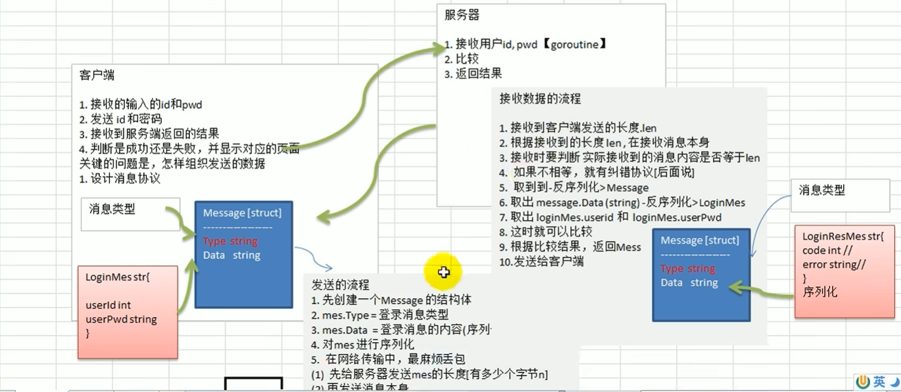

# TalkMesh

基于 Go 的 TCP 聊天系统学习项目。目前已经完成基础登录流程，正在逐步加入注册、在线用户和消息通信功能。



## 已实现

- 客户端与服务端 TCP 通信
- 4 字节长度头 + JSON 消息协议
- 服务端为每个连接启动 goroutine
- 根据消息类型路由到对应处理逻辑
- 基础登录和登录结果返回
- 简单的客户端控制台菜单

测试账号：

```text
用户 ID：114514
密码：qwe
```

## 项目结构

```text
TalkMesh/
├── client/              # 客户端
├── common/
│   ├── message/         # 消息协议
│   └── utils/           # TCP 数据包读写
├── serve/
│   ├── main/            # 服务端入口和消息路由
│   └── process/         # 登录等业务处理
├── go.mod
└── README.md
```

## 运行

先启动服务端：

```bash
go run ./serve/main
```

再打开另一个终端启动客户端：

```bash
go run ./client
```

服务端默认监听 `0.0.0.0:8899`。

## 消息格式

每条消息由长度头和 JSON 消息体组成：

```text
4 字节长度 + JSON 数据
```

```go
type Message struct {
    Type string `json:"type"`
    Data string `json:"data"`
}
```

## 开发计划

- [ ] 完善 TCP 分包读取和错误处理
- [ ] 实现用户注册
- [ ] 接入 Redis
- [ ] 维护在线用户列表
- [ ] 实现一对一聊天和群聊
- [ ] 增加心跳和重连
- [ ] 补充测试

本项目主要用于学习 Go 网络编程，目前还未达到生产级聊天系统的标准。
