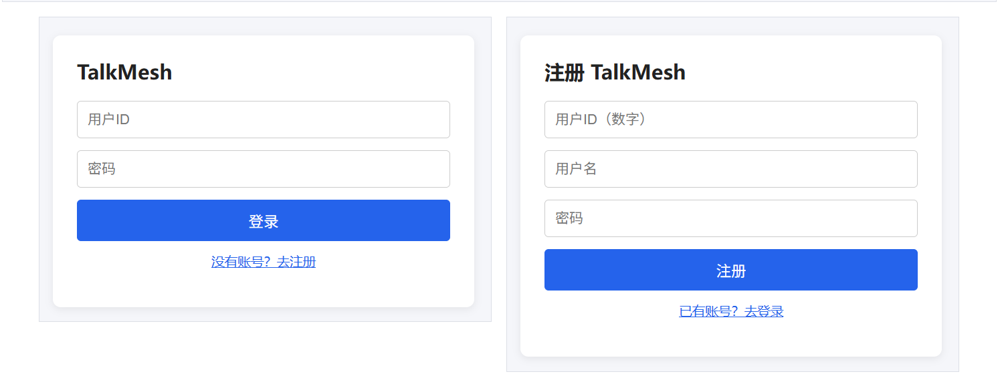

# TalkMesh

用 Go 写的 TCP 即时通讯学习项目：自定义二进制协议 + 终端客户端 + 浏览器网页端，覆盖注册登录、在线状态、群聊、私聊、心跳和离线消息。

## 功能

- **终端客户端**：注册、登录、在线用户列表、群聊、私聊、心跳保活
- **网页端**：注册、登录、左右分栏聊天页、消息气泡、消息时间戳、每 2 秒轮询刷新、群聊/私聊、退出
- **服务端**：同时监听 TCP `8899` 和 HTTP `8900`，网页层复用同一套登录、在线表、消息和离线逻辑
- **基础可靠性**：包长校验、读写超时、心跳清理、离线队列、身份以服务端连接为准

## 截图

上：聊天页；下：登录页与注册页。



## 技术栈

| 层 | 技术 |
| --- | --- |
| 语言 | Go 1.27 |
| TCP / HTTP | 标准库 `net`、`net/http`、`embed` |
| 存储 | Redis（redigo 连接池） |
| 前端 | 原生 HTML / CSS / JavaScript（`fetch` 轮询，无框架） |

## 架构

```text
浏览器 ──HTTP──> serve/web（Session + Cookie）
                    │ 自定义 TCP 协议
                    ▼
              serve（8899：登录、在线表、群聊/私聊、离线队列）──> Redis
                    ▲
终端客户端 ──TCP────┘
```

网页层相当于“另一个 IM 客户端”：浏览器不会说自定义协议，由 `serve/web` 在后台维持一条到 8899 的 TCP 连接。

## 项目结构

```text
TalkMesh/
├── client/                 # 终端客户端
│   ├── main/               # 登录/注册菜单
│   ├── model/              # 当前用户
│   └── process/            # 登录、注册、群聊、私聊、心跳
├── common/
│   ├── message/            # 协议结构体
│   └── utils/              # 长度头 + JSON 的 ReadPkg / WritePkg
├── serve/
│   ├── main/               # 启动 TCP 8899 + HTTP 8900、路由
│   ├── process/            # 登录、在线表、群聊/私聊、离线、心跳
│   ├── model/              # Redis 用户数据访问
│   └── web/                # 网页层
│       ├── web.go          # 路由、handler、/api/messages
│       ├── session.go      # Session、心跳、读循环、消息上限
│       └── static/         # 登录/注册/聊天页、CSS、JS（embed 打包）
├── ROADMAP.md
├── go.mod
└── README.md
```

## 快速开始

依赖：Go 1.27+、Redis（`127.0.0.1:6379`）。

准备一个测试账号：

```bash
redis-cli HSET users 114514 '{"userId":114514,"userPwd":"qwe","userName":"测试用户"}'
```

启动服务端：

```bash
go run ./serve/main
```

服务端会同时监听：

- `127.0.0.1:8899`：TCP IM 协议
- `127.0.0.1:8900`：网页界面

浏览器打开 `http://127.0.0.1:8900`，可以注册新账号，或用 `114514 / qwe` 登录。登录后左栏发群聊/私聊，右栏每 2 秒自动刷新。

终端客户端：

```bash
go run ./client/main
```

## 协议

每条消息 = **4 字节大端长度 + JSON 消息体**。

外层统一是 `Message`，`Data` 里再放一层业务 JSON：

```go
type Message struct {
    Type string `json:"type"`
    Data string `json:"data"`
}
```

一个登录包：

```json
{"type":"LoginMes","data":"{\"userId\":114514,\"userPwd\":\"qwe\"}"}
```

主要消息类型：

| 类型 | 方向 | 作用 |
| --- | --- | --- |
| `LoginMes` / `LoginResMes` | 双向 | 登录；响应带 `code` 和在线用户列表 `users` |
| `RegisterMes` / `RegisterResMes` | 双向 | 注册；`code` 200 成功 / 400 已存在 / 401 参数不合法 |
| `NotifyUserStatusMes` | 服务端 → 客户端 | 上下线通知，含 `userId` / `userName` / `status` |
| `SmsMessage` / `SmsTransferMes` | 双向 | 群聊请求与转发 |
| `SmsToUserMes` / `SmsToUserTransferMes` / `SmsToUserResMes` | 双向 | 私聊请求、转发、结果 |
| `PingMes` / `PongMes` | 双向 | 心跳 |

协议细节见 `common/message/message.go`。

## 网页接口

| 方法 | 路径 | 作用 |
| --- | --- | --- |
| `GET` | `/` | 登录页 |
| `GET` / `POST` | `/register` | 注册页 / 提交注册 |
| `POST` | `/login` | 登录并写 Cookie |
| `GET` | `/chat` | 聊天页 |
| `GET` | `/api/messages` | 当前会话消息 JSON，供页面轮询 |
| `POST` | `/sendall` / `/sendone` | 发群聊 / 私聊 |
| `GET` | `/logout` | 退出并清理会话 |

`/api/messages` 返回 `me` 和 `messages`，`messages` 里每条带 `type`（`group` / `private` / `notify` / `result`）和 `time`（收到消息的时刻，补发/轮询时不会变化），前端据此渲染气泡或系统提示。

## 已知限制

- 同一个浏览器只能登录一个账号（Cookie 按域名共享）；测试多账号请用无痕窗口或不同浏览器 Profile。
- 同一账号多端登录会互相覆盖在线表，旧连接可能残留到超时或手动退出。
- 密码明文存 Redis，尚未使用 bcrypt。
- Cookie 未设置 `HttpOnly` / `Secure`，仅适合本机学习。
- 网页发送仍是表单 POST 后跳转，不是无刷新发送。

## 开发计划

见 [ROADMAP.md](ROADMAP.md)。

## 说明

本项目用于学习 Go 网络编程、协议设计、并发与 Web 接入，尚未达到生产级聊天系统的标准。
